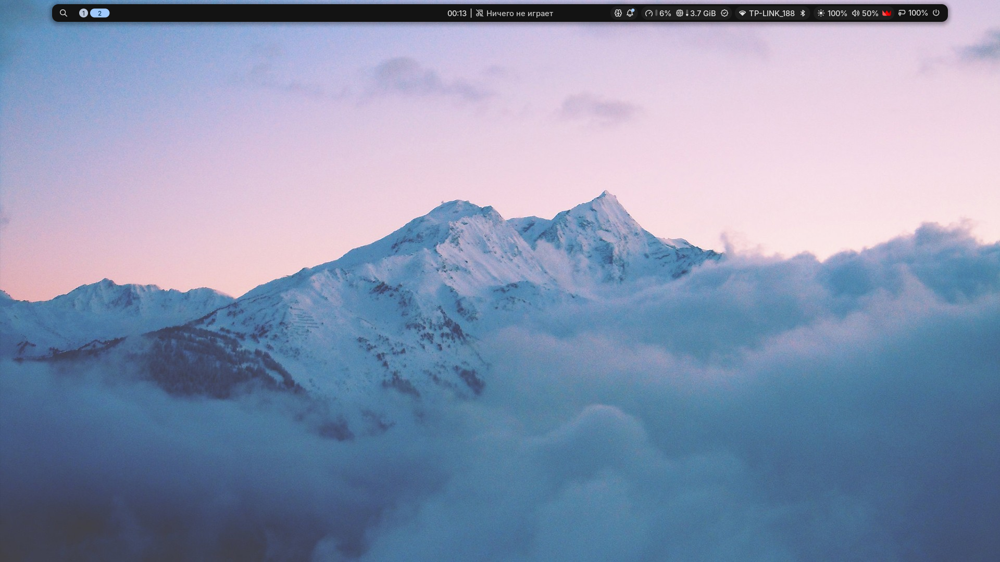

# NixOS configuration

Personal [NixOS](https://nixos.org/) + [Home Manager](https://github.com/nix-community/home-manager) flake for two machines. Secrets use [sops-nix](https://github.com/Mic92/sops-nix).



## Hosts

- **`ideapad`** — laptop with AMD graphics, btrfs/LUKS, TPM2, Lanzaboote Secure Boot and niri.
- **`homelab`** — Proxmox VM with the self-hosted stack (nginx, Forgejo, Vaultwarden, Authelia, OpenCloud, Open WebUI and media services).

## Layout

| Path | Purpose |
|---|---|
| `hosts/<name>/` | Host-specific NixOS configuration |
| `hosts/common/` | Shared NixOS modules |
| `home-manager/bagoont/` | User and per-host configuration |
| `home-manager/common/` | Reusable user modules |
| `modules/` | Publishable parameterized modules |
| `pkgs/`, `overlays/` | Local packages and overlays |
| `secrets/` | Encrypted sops/age secrets |

## Keyboard shortcuts

See [KEYBINDINGS.md](KEYBINDINGS.md) for configured shortcuts and everyday application defaults.

## Development

Entering the repository with direnv loads `shell.nix` (run `direnv allow` once).
It provides `pre-commit`, `mcp-nixos` and `forgejo-mcp`.

```sh
nix fmt -- <changed-files>                         # format with alejandra
nix fmt -- --check <changed-files>                 # check formatting
nix flake check                                    # evaluate flake checks
nixos-rebuild dry-build --flake .#ideapad          # or .#homelab
```

Nix evaluation sees only Git-tracked files. Add new files before running checks.
Do not run activation commands from automation; use `switch` only when deliberately
applying a reviewed configuration on the target host.

## ideapad: one-time Secure Boot setup

The machine-specific configuration enables Lanzaboote, TPM2 and encrypted disks.
After configuring firmware keys, use `sbctl create-keys` and
`sbctl enroll-keys --microsoft` as appropriate. Enroll each declared LUKS device
with `systemd-cryptenroll --tpm2-device=auto /dev/disk/by-uuid/<luks-uuid>`.
Keep the LUKS passphrase as a fallback and verify boot before enabling Secure Boot.
